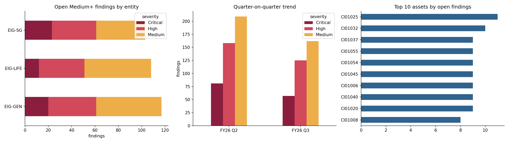
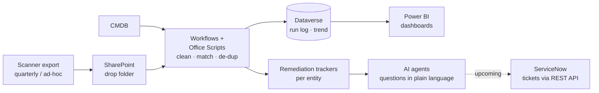

# SecOps Automation Demo: vulnerability tracking and account reviews

An insurer's IT security team was spending days every quarter turning scanner exports and directory reports into Excel trackers by hand. I worked on automating that work with **AI agents, workflows and dashboards**. This repo shows the core logic on **synthetic data**, so it can be run and read publicly.

> **About the data:** everything in `data/` is generated by [`data/generate_synthetic_data.ps1`](data/generate_synthetic_data.ps1) for a fictitious *Example Insurance Group* (`corp.example.com`). No client data, hostnames or names are included. The generator deliberately reproduces the data problems found in real exports.

| Notebook | What it automates | Open |
|---|---|---|
| [01 · Vulnerability pipeline](notebooks/01_vulnerability_pipeline.ipynb) | Quarterly + ad-hoc scans → CMDB match → de-duplicated remediation tracker per entity → dashboard → "ask the agent" query |  |
| [02 · Account security review](notebooks/02_account_security_review.ipynb) | On-prem AD + Entra ID merge → review criteria → master tracker + one sheet per reviewer → dashboard |  |

## How the production solution is built

The real solution runs on Microsoft Power Platform. The notebooks reproduce the same steps in Python.

## Real-world problems this handles

| Problem in the source data | Effect if ignored | How it's handled |
|---|---|---|
| Scanner re-keys assets, so one finding has two records | Findings double-counted | De-duplicate on **asset · plugin · port**, keep the latest |
| `finding_id` changes between exports | Every finding looks "new" each quarter | Carry forward on the finding key, never on the id |
| Same server as FQDN, short name or IP | Assets miss the CMDB | Normalise names, fall back to IP |
| Ad-hoc rescan only runs local checks | Network findings falsely closed | Only close what the rescan actually covered; humans confirm |
| Unfixable findings recast to *Info* | Noise in trackers | Track Medium+ only; keep vendor severity for reference |
| AD dates stored day-first | Day and month silently swapped | Parse with the correct format and report the difference |
| Manager names masked in AD | Can't route reviews | Route on manager email |

## Run it

Click an **Open in Colab** badge, then **Runtime → Run all**. The first cell clones this repo, so nothing else is needed. Locally: `pip install pandas matplotlib openpyxl` and open the notebooks in Jupyter.

## Tech

Python · pandas · matplotlib · Power Automate · Office Scripts (TypeScript) · SharePoint · Dataverse · Power BI · GitHub Copilot / Copilot Studio agents · ServiceNow REST API
